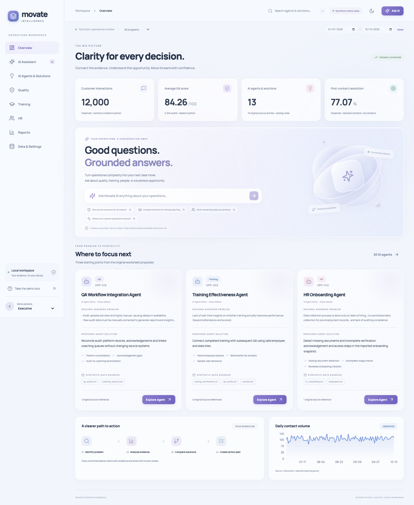
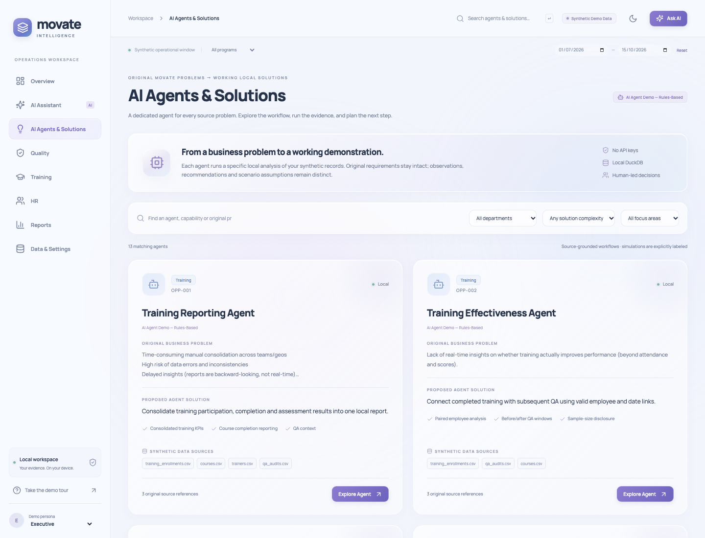

# Movate AI Operations Intelligence

A runnable, local-first operations demo: inspect a business problem, ask a grounded question, compare three source-supplied alternatives, and create an editable plan for human review.

**Every record is synthetic.** Program names are scenario labels taken from the supplied worksheets, not evidence of Movate client relationships. Worksheet impact claims are proposals; scenario economics are illustrative USD assumptions, not validated forecasts.



## Vercel deployment

Deployment preparation is included; nothing has been published. Follow the exact [GitHub → Vercel instructions](docs/VERCEL.md), including the required server-only access credentials. The hosted demo uses a bundled read-only dataset and explicitly browser-local chats and action-plan drafts. Local development continues to use SQLite. See [verification results](docs/VERCEL_VERIFICATION.md).

## Start locally

Requirements: Python **3.10+**, Node **22.12+**, npm, and the supplied dataset ZIP. No Docker, cloud service, API key, or deployment is needed. Font files are installed locally via npm; the interface does not request a web font service.

```bash
cd /Users/akhilbabbar/movate-ai-intelligence
bash scripts/setup.sh
npm run dev
```

Initial setup creates `.venv`, installs dependencies, creates `.env` if absent, discovers/imports the real source files, and validates them. Dependencies are already installed in this delivered workspace, so **`npm run dev` is sufficient**.

Open **http://127.0.0.1:5173**. API documentation: **http://127.0.0.1:8000/docs**. Stop both servers with Ctrl+C. The launcher checks occupied ports and cleans up its child processes. Optional `BACKEND_PORT` and `FRONTEND_PORT` in `.env` change ports; Vite’s proxy follows the configured backend port.

To run separately:

```bash
.venv/bin/python -m uvicorn backend.main:app --host 127.0.0.1 --port 8000
# another terminal
npm --prefix frontend run dev
```

Build the frontend with `npm run build`. The runtime backend remains a separate local FastAPI service; a static bundle alone cannot execute analytics or chat.

### Windows (PowerShell)

```powershell
py -3 -m venv .venv
.\.venv\Scripts\python.exe -m pip install -r requirements-dev.txt
npm --prefix frontend install
Copy-Item .env.example .env
.\.venv\Scripts\python.exe -m backend.data
npm run dev
```

The one-command launcher uses `python3`; if Windows exposes only `py` or `python`, run `py scripts/start.py` instead. The Windows instructions are provided but have not been exercised on Windows.

## Source files and discovery

The original archive and workbooks were found in `/Users/akhilbabbar/Downloads/`:

- `Movate_Synthetic_Dataset_v1.zip`
- `Opportunities for automation and process improvement - QA_CI.xlsx`
- `Opportunities for automation and process improvement_Chris.xlsx`
- `Opportunities for automation and process improvement_HR.xlsx`
- `Opportunities for automation and process improvement_Training.xlsx`

Configure another machine using absolute paths in `.env`:

```dotenv
MOVATE_DATA_ZIP=/absolute/path/Movate_Synthetic_Dataset_v1.zip
MOVATE_WORKBOOK_DIR=/absolute/path/to/workbooks
```

Discovery checks configurable paths, the project’s `data/`, and the current OS user’s Downloads/Desktop folders. It prunes hidden/dependency directories and bounds recursion. Filenames with or without `(1)` are supported. It never searches system directories. The ZIP is extracted to `data/raw/movate_synthetic_data/` with path-traversal and entry-size checks. The original ZIP is never modified. Workbook copies are preserved in `data/workbooks/`; all nonempty requirement cells and coordinates are preserved in `data/processed/workbook_rows.json`.

If XLSX files are missing, the two source CSVs remain the authoritative available requirements; the UI discloses the missing originals. Missing or failed input imports show diagnostics and expected path configuration, with no fabricated replacement data. Refreshing in **Data & Settings → Data health** preserves saved user work. A failed refresh retains the previous database on disk but blocks analytics until a valid import, preventing accidental presentation of stale data as a successful new import.

### Validated source results

| Input | Imported rows |
| --- | ---: |
| Interactions | 12,000 |
| QA audits | 2,200 |
| Employees | 240 |
| Training enrollments | 1,000 |
| Original source entries | 19 |
| Canonical opportunities | 13 |
| Solution alternatives / scenarios | 39 / 39 |
| CSV tables | 21 |

Operational default window: **July 1–October 15, 2026**. Audit timestamps can extend beyond the contact window; reporting metrics use explicit audit dates. UI date filters remain inside the operational window. API periods are clipped to that window and invalid/reversed/nonintersecting ranges are rejected.

The importer validates dictionary headers/counts, inferred data types/nulls/date ranges (persisting date fields as DATE and event timestamps as TIMESTAMP), primary keys, metric ranges, source mappings, 12 declared relationships plus additional conventional ID links, contextual employee/program/audit coherence, all scenario equations, and daily KPI reconciliation. All validated joins have zero orphan rows. Daily contacts, AHT, FCR, CSAT, SLA, service cost and peak contacts reconcile within source rounding precision.

Six repeated source references are intentional: the three training opportunities each appear in Chris, QA_CI and Training. Sixteen source rows match exact workbook text. The remaining three QA rows differ only in surrounding whitespace in the CSV’s problem text; exact workbook cells are retained and accessible in the original-requirement view. No worksheet text is invented.

## Features

**New: [AI Agents & Solutions](docs/AI_AGENTS.md)** adds a dedicated local workflow for each canonical source problem, with six-section workspaces, real Run Agent analysis, observed findings, explicit integration limits and editable reviewed drafts. No agent requires or calls an LLM/API. Legacy opportunity URLs redirect to `/agents` with query parameters preserved.




- Executive overview with computed KPIs, question entry, priority source problems and a modest real-data trend.
- AI Agents & Solutions with 13 dedicated agent cards, name/capability/problem search, department/program/complexity/focus filters, original requirements and every source reference. All 13 agents run distinct local analyses and retain the three supplied solution alternatives.
- Grounded assistant with scoped evidence, deterministic calculations, local conversations, follow-ups, citations, answer export and recommendation drafts.
- Scenario lab with editable adoption, hours, loaded hourly cost, effort reduction, case multipliers and a timeline constraint. First-year and recurring-year economics are separate.
- Quality summaries, linked sample coverage, finding breakdowns, audit → employee → coaching drilldown and paginated evidence.
- Training enrollments/courses/trainers plus temporally valid paired before/after QA associations with sample sizes and disclosed methodology.
- HR onboarding snapshot, recognition, restricted masked cases, local access audit events and explicit human-review requirements.
- Filtered JSON reports, KPI CSV exports, print/save-PDF, saved drafts and recorded approvals.
- Source mapping, actual-schema dictionary, paginated source-record inspector, import diagnostics and provider testing.
- Light/dark themes, mobile navigation, keyboard focus handling, reduced-motion support and a six-step guided demo.

Program filtering keeps cross-program QA, Training and HR requirements and narrows program-specific Customer Operations proposals using original program_context references. The **focus-area filter** is a disclosed workflow grouping (Quality review → QA, People workflows → HR, Enablement → Training); the source does not supply a factual priority ranking. Catalog-wide opportunity counts are not represented as period-specific operational counts. Source financial assumptions are never summed into a misleading savings headline.

## Architecture

```text
React / TypeScript / Vite
  React Router · TanStack Query · Motion · Recharts
  Tailwind CSS · shadcn-style Radix/CVA button · Lucide · local Manrope
        │ same-origin /api proxy
FastAPI / Pydantic / structured request logs
        ├── parameterized analytics templates → read-only DuckDB
        ├── bounded evidence retrieval → optional provider → output checks
        └── SQLite → persona-scoped chats, plans, append-only audit events

Source ZIP / XLSX → pandas / openpyxl → validation → atomic DuckDB replacement
```

No user/model SQL endpoint exists. Application-owned queries use parameters; table inspection uses a fixed allowlist. Read-only connections disable external file/network access. Raw employee and HR tables are excluded from the general inspector/export API, including for the HR persona. HR case views omit employee IDs and names, and are enforced by the backend role dependency. The AI uses only aggregate HR context, never individual cases/onboarding rows.

```text
backend/
  data.py          discovery, source preservation, ingestion and validation
  analytics.py     scopes, deterministic KPIs, temporal joins, scenario equations
  ai.py            intent/entity detection, retrieval, fallback, provider validation
  agents.py        13 source-linked, deterministic local agent workflows
  storage.py       SQLite conversations, plans and audit trail
  main.py          REST API, roles, errors and structured logs
  tests/           real-data, security, economics and API checks
frontend/
  src/App.tsx      navigation, screens and complete demo workflows
  src/styles.css   glass design system, themes and responsive/reduced-motion rules
  src/components/ui/button.tsx
  tests/           Playwright workflow/navigation tests
scripts/
  setup.sh         macOS/Linux setup and initial import
  start.py         one-command local process launcher
  screenshots.mjs  optional screenshot capture (see below)
data/
  raw/             extracted original CSV files (ignored)
  workbooks/       preserved original XLSX copies (ignored)
  processed/       DuckDB, SQLite, original workbook rows and validation status (ignored)
docs/
  IMPLEMENTATION.md
  VERIFICATION.md
  screenshots/
```

## AI configuration and grounding

The delivered default is **`LLM_PROVIDER=disabled`**. The UI labels results **Rules-based analysis**. This is deterministic analysis of retrieved records, not a simulated LLM or hardcoded answer script. Optional provider inference has **not** been verified against a real model or API key in this workspace.

For an OpenAI-compatible provider:

```dotenv
LLM_PROVIDER=openai
LLM_BASE_URL=https://YOUR_PROVIDER_API_ROOT/v1
LLM_MODEL=YOUR_AVAILABLE_MODEL
LLM_API_KEY=YOUR_KEY
```

For a local Ollama service with an already-installed model:

```dotenv
LLM_PROVIDER=ollama
LLM_BASE_URL=http://127.0.0.1:11434
LLM_MODEL=YOUR_INSTALLED_MODEL
LLM_API_KEY=
```

Restart the backend, then use **Data & Settings → AI provider → Test connection**. No model, credentials, or connected status is assumed. The OpenAI-compatible adapter expects a traditional chat-completions endpoint supporting temperature and max_tokens; providers with different request contracts need an adapter change. Provider keys stay on the backend and are not returned by an API. If configured, compact aggregate/source evidence is sent to that endpoint; keep the provider disabled for entirely offline analytics.

Pipeline:

1. Detect department, source opportunity, program labels and explicit ISO date ranges; retain a bounded recent-question context for follow-ups.
2. Retrieve relevant canonical/source opportunities, supplied alternatives and matched knowledge articles.
3. Calculate numbers with application-owned parameterized templates and Python equations.
4. Return a useful deterministic answer, evidence, three alternatives, assumptions and review-led next steps.
5. Optionally request structured provider JSON over compact evidence; validate its schema, citation allowlist, numeric references and prohibited causal/statistical claims.
6. Preserve the deterministic direct answer and calculated option table regardless of provider output. Show provider explanations as AI inference. Fail back visibly if inference is unavailable or grounding checks fail.
7. Save conversations locally by persona; new chat and resume are available.

Provider output is buffered until grounding validation finishes; a progress state appears during analysis. Token streaming is deliberately not rendered before validation. Automated grounding checks cannot establish the truth of every qualitative model sentence; human review remains necessary. No calibrated model confidence score is shown.

## Economics and analytical definitions

```text
annual gross savings = annual hours × loaded hourly cost × reduction% / 100 × adoption% / 100
first-year total cost = one-time cost + 12 × monthly cost
first-year net benefit = annual gross savings − first-year total cost
first-year ROI% = first-year net benefit / first-year total cost × 100
recurring-year net benefit = annual gross savings − 12 × monthly cost
```

Conservative/Base/Optimistic apply **0.75 / 1 / 1.2** to the source effort-reduction assumption (capped at 100%), holding other inputs constant. Recommendation ranks eligible options by highest first-year modeled net benefit subject to the editable time constraint. Negative net benefits remain visible; ranking is not an investment endorsement. Full-year steady-state adoption is assumed; ramp, discounting, implementation timing and double-counted opportunity benefits are not modeled. Alternatives and overlapping opportunities must not be summed.

Quality coverage uses **unique contacts created in the reporting period with an audit also dated in that period / contacts created in the period**. The overview audit count instead uses audit date; its audit-volume ratio is labeled separately in API output.

Training uses one first completed enrollment per employee assigned in scope. It pairs employees with audits both before and after completion, uses 30-day windows clipped to the reporting period, excludes completion day and averages employee means. Repeated enrollments do not repeatedly count the same employee. Other courses, selection effects and confounding are uncontrolled, so differences are associations, not causality. Course/trainer post-assessments use enrollments completed by the period end. Pre-assessment and post-assessment aggregate denominators are explicitly labeled and may differ for partial periods.

Onboarding is an imported snapshot covering historical hires. It is program-filtered but does not pretend to represent hires in the reporting date range. Cases and recognition use opened/recognition dates. Parallel checklist counts can overlap.

## Roles and human review

Choose Executive, QA Manager, Training Manager or HR Manager from the sidebar. This is **demo role simulation, not production authentication**: a local caller can select the `X-Demo-Role` header. Backend enforcement still applies to each selected persona. Bind to localhost and use only synthetic data.

- Audit drilldown: Executive and QA Manager.
- Masked HR cases and onboarding rows: HR Manager only; AI context excludes these rows for every role.
- Source refresh: Executive.
- Plan approval: corresponding department manager; Customer Operations requires Executive. A named reviewer is mandatory.
- Chats, saved plans and audit-event lists are persona-scoped. Switching personas does not expose another persona’s saved chats.

Approval records a review artifact only. No plan executes an operational change, issues discipline, or makes a personnel decision. Audit events are append-only through application/SQLite triggers, not tamper-proof against a database administrator.

## Five-minute demo and test questions

1. Overview: show the four observed/catalog KPIs and persistent Synthetic Demo Data label.
2. Open AI Agents & Solutions; explore a dedicated agent, inspect its original worksheet text and source row, then click Run Agent.
3. Ask about Activision QA; expand measured findings and source citations.
4. Open comparison; change adoption or hourly cost; compare cases and select an option.
5. Generate a plan, edit it, and save a draft. Approval requires a named responsible reviewer.
6. Briefly inspect Quality, Training and HR. Switch personas to demonstrate backend-enforced masked access.
7. Show Source mapping / Data health. The sidebar tour guides six steps.

Example questions (also available in the assistant):

1. Why are QA scores low for Activision, and what are the best three solutions?
2. Find the major quality issues and groups needing coaching.
3. How much of the contact volume has been audited?
4. Compare solutions for fragmented training reporting.
5. Does completed training associate with better QA scores?
6. Which courses need a refresher and why?
7. Summarize trainer capability and assessment results.
8. What onboarding steps are pending?
9. Draft an HR onboarding process checklist.
10. What are the human review requirements for disciplinary workflows?
11. Where can customer operations improve first-contact resolution?
12. Compare conservative and optimistic solution economics.
13. What evidence supports QA management system consolidation?
14. Show original workbook sources for employee engagement.

Intent/entity routing is rules-based and limited to the imported business domains. Unsupported questions disclose missing evidence. It is not a general-purpose query engine or a predictive model.

## API

Interactive schemas and request examples are available at `/docs`.

| Route | Purpose |
| --- | --- |
| `GET /api/health` | Process and import readiness |
| `GET /api/data/status` | Schemas, dates, joins, original source mapping, diagnostics |
| `POST /api/data/import` | Discover/extract/import/revalidate; optional `zip_path` |
| `GET /api/agents`, `/api/agents/{id}`, `POST /api/agents/{id}/run` | Source-linked agent directory, six-section workspace metadata and local deterministic execution |
| `GET /api/overview`, `/api/programs`, `/api/operations/summary` | Filtered overview, linked operations/sales/ticket aggregates, and program catalog |
| `GET /api/opportunities`, `/api/opportunities/{id}` | Search/filter catalog and full original references |
| `GET /api/qa/summary`, `/api/qa/audits` | Quality aggregates and paginated authorized drilldown |
| `GET /api/training/summary`, `/api/hr/summary` | Department analytics with privacy boundaries |
| `GET /api/scenarios/{id}`, `POST /api/scenarios/compare` | Supplied alternatives and validated what-if calculations |
| `POST /api/ai/chat` | Scoped grounded response and persistent conversation |
| `GET /api/ai/prompts`, `/api/ai/provider`, `POST /api/ai/provider/test` | Examples and actual inference connectivity check |
| `GET /api/chats`, `/api/chats/{id}` | Persona-scoped conversations |
| `POST /api/action-plans`, `GET /api/action-plans` | Reviewed drafts and approval artifacts |
| `GET /api/reports/summary`, `/api/reports/export` | Filtered report; JSON or KPI CSV |
| `GET /api/data/table/{table}` | Allowlisted paginated original-record inspection |
| `GET /api/audit-log` | Persona-scoped local audit events |

Analytics accept `program` (program ID), `start` and `end` ISO dates. Lists use bounded `limit` and `offset` where appropriate. Errors use `{ "error": { "code": ..., "message": ... } }`. Pydantic validates date windows, ranges, financial inputs and approval schemas.

## Tests and screenshots

```bash
.venv/bin/python -m pytest backend/tests -q
npm test
npm run build
# Start application in another terminal before browser tests:
npm run dev
# First-time Chromium setup:
cd frontend
npx playwright install chromium
npm run test:e2e
```

Browser tests cover all 13 Explore/Run Agent workflows and their six sections, legacy links and scope changes, plus the guided workflow, source traceability, grounded chat/follow-up/resume, scenario recalculation, editable plan persistence, audit drilldown, masked HR roles, reports/downloads, navigation, theme and mobile/reduced-motion behavior. Backend tests isolate saved user work in temporary SQLite files. **Browser tests create synthetic conversations and draft plans in the local workspace**, leaving them available for review.

Test screenshots are in `docs/screenshots/`. See `docs/VERIFICATION.md` for actual results and fixes. To capture a clean overview, comparison, chat, agent directory, QA agent results and mobile preview manually, run `node scripts/screenshots.mjs` while servers are running. This script uses the installed Playwright browser; set `PLAYWRIGHT_BROWSERS_PATH` if you installed it in a custom location.

### Troubleshooting and limits

- Missing input: configure `MOVATE_DATA_ZIP` / `MOVATE_WORKBOOK_DIR`; inspect Data health; rerun `.venv/bin/python -m backend.data`.
- Occupied port: stop the old process or change `.env` ports. Permission denied: allow localhost binding in the terminal/sandbox.
- No LLM/key/model: rules-based analysis remains functional. No real provider inference has been claimed or tested.
- No internet at setup: dependencies and optional browser installation need one initial download; normal analytics run locally afterward.
- Browser sandbox on macOS: Chromium may require normal host process permissions for end-to-end tests.
- No automatic audio/call scoring, validated speech accuracy, causal training attribution, financial forecast validation, or operational system writes are claimed.
- This demo does not supply production identity, encryption-at-rest, multi-user concurrency controls, retention policies, calibrated prediction, or tamper-resistant audit infrastructure.
- Storage is local to this project. Back up `data/processed/workspace.sqlite` for saved work. Do not commit `.env`, source datasets, local databases, or API keys.
